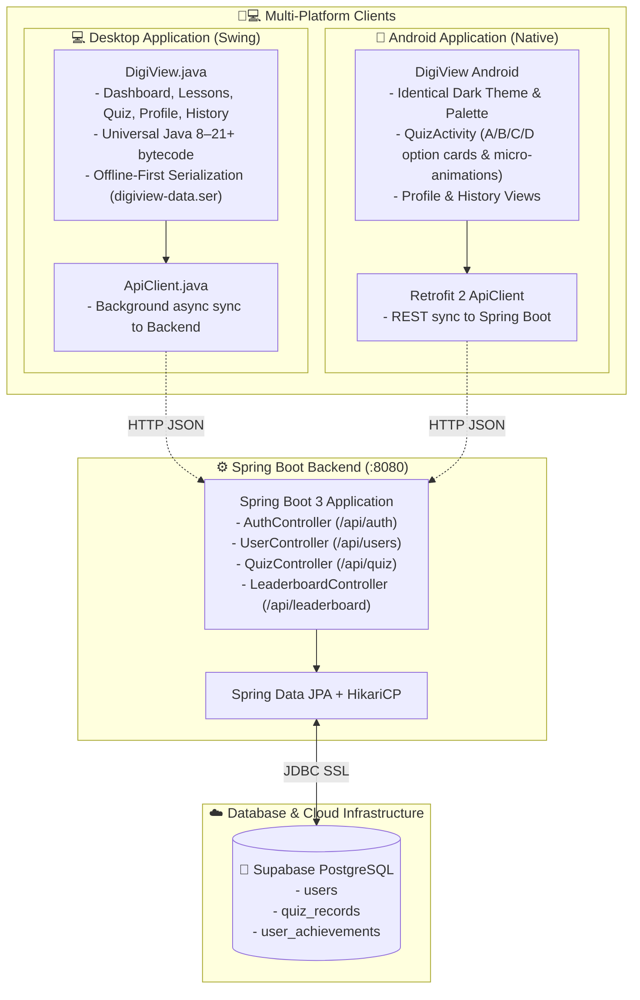

# 🏛️ DigiView Learning Management System - Architecture & Project Structure

Welcome to the **DigiView System** repository. This document provides a complete visual diagram, directory tree, and detailed explanation of every directory and file across the **Desktop Application (Java Swing)**, **Backend Server (Spring Boot & Supabase)**, and **Android Mobile Client**.

---

## 🌐 System Architecture Diagram



---

## 📂 Visual Directory Tree

```text
Digi_View_System/
│
├── 📜 README.md                  # Quick start guide & instructions for developers
├── 📜 build-android.bat          # 📱 One-click Android APK compiler (auto-SDK detection)
├── 📜 manage-android.bat         # 📱 Android management toolkit (build, run, install, logs, devices)
├── 📜 build-release.bat          # Bundles self-contained zero-install ZIP with Java 17 runtime
├── 📜 build.xml                  # Apache Ant build script for NetBeans IDE
├── 📜 manifest.mf                # JAR Manifest defining main entry point System.DigiView
├── 📜 run.bat                    # One-click desktop launcher (compiles & runs via javaw)
├── ⚙️ render.yaml               # ☁️ Render Cloud Blueprint specification (Infrastructure as Code)
├── 📜 PROJECT_STRUCTURE.md       # Complete repository architecture and documentation
├── 🙈 .gitignore                 # Excludes build/, dist/, bin/, *.log, .gradle/, .env
│
├── 📁 .vscode/                   # IDE Run & Debug configurations
│   ├── ⚙️ launch.json            # F5 one-key launcher config
│   └── ⚙️ settings.json          # Source path (src) and output path (bin) bindings
│
├── 📁 nbproject/                 # Apache NetBeans project configuration
│   ├── ⚙️ build-impl.xml         # Ant build targets generated by NetBeans
│   ├── ⚙️ genfiles.properties    # NetBeans CRC checksum tracker
│   ├── ⚙️ project.properties     # Universal Java 8 (1.8) source/target level & classpath
│   └── ⚙️ project.xml            # NetBeans project type and metadata
│
├── 📁 src/System/                # 💻 DESKTOP SWING APPLICATION
│   ├── ☕ ApiClient.java         # Pure Java HTTP client syncing quiz data to Spring Boot
│   ├── ☕ DigiView.java          # Complete desktop LMS GUI (Dashboard, Lessons, Quiz, Profile, History)
│   └── 📁 sounds/                # Audio sound effects
│       ├── 🔊 freesound_community-relax-32200.mp3
│       ├── 🔊 mixkit-select-click-1109.wav
│       └── 🔊 mixkit-single-key-type-2533.wav
│
├── 📁 backend/                   # ⚙️ SPRING BOOT & SUPABASE BACKEND
│   ├── 🐳 Dockerfile             # Multi-stage production container for Render deployment
│   ├── 📄 .dockerignore          # Excludes build caches and secrets from container image
│   ├── 🔒 .env                   # Local secrets (gitignored, contains real Supabase password)
│   ├── 📜 .env.example           # Safe template for credentials (committed to git)
│   ├── 📜 build.gradle           # Spring Boot 3.3.4, JPA, PostgreSQL, Validation
│   ├── 📜 settings.gradle        # Project naming (digiview-backend)
│   ├── 📜 run-backend.bat        # One-click script to run the Spring Boot server
│   ├── 📜 schema.sql             # Supabase PostgreSQL DDL (tables, constraints, indexes)
│   └── 📁 src/main/
│       ├── 📁 resources/
│       │   └── ⚙️ application.properties # Supabase DB connection URL, pool, and server port
│       └── 📁 java/com/digiview/
│           ├── ☕ DigiViewApplication.java # Spring Boot main entry point
│           ├── 📁 config/
│           │   └── ☕ CorsConfig.java       # Cross-Origin configuration for Desktop & Mobile
│           ├── 📁 entity/                   # JPA Database Tables
│           │   ├── ☕ UserEntity.java        # maps to 'users' table
│           │   ├── ☕ QuizRecordEntity.java  # maps to 'quiz_records' table
│           │   └── ☕ AchievementEntity.java # maps to 'user_achievements' table
│           ├── 📁 repository/               # Spring Data JPA Repositories
│           │   ├── ☕ UserRepository.java
│           │   ├── ☕ QuizRecordRepository.java
│           │   └── ☕ Achieve│               ├── ☕ AuthController.java   # /api/auth/register, /api/auth/login
│               ├── ☕ UserController.java   # /api/users/{username}, /api/users/{username}/xp
│               ├── ☕ QuizController.java   # /api/quiz/record, /api/quiz/history/{username}
│               ├── ☕ LeaderboardController.java # /api/leaderboard
│               └── ☕ HealthController.java # /health, /, /api/health for Render uptime monitoring
│
├── 📁 android/                   # 📱 ANDROID NATIVE PORT
│   ├── 📜 build.gradle           # Root Gradle build file with Google & Maven repositories
│   ├── 📜 settings.gradle        # Includes ':app' module
│   └── 📁 app/
│       ├── 📜 build.gradle       # SDK 34, ViewBinding, Material Components, Retrofit 2
│       └── 📁 src/main/
│           ├── 📄 AndroidManifest.xml # Internet permissions & MainActivity declaration
│           ├── 📁 res/
│           │   ├── 📁 values/
│           │   │   ├── 🎨 colors.xml # Exact hex tokens from Swing (#050F23, #071120, #0E1B30, etc.)
│           │   │   └── 🎨 themes.xml # Dark theme matching desktop aesthetics
│           │   ├── 📁 drawable/      # UI Shapes & Vector Drawables
│           │   │   ├── 🖼️ bg_gradient.xml       # Diagonal background gradient
│           │   │   ├── 🖼️ bg_card.xml           # 22dp rounded card with border stroke
│           │   │   ├── 🖼️ bg_card_outline.xml   # Transparent outline tile
│           │   │   ├── 🖼️ bg_button.xml         # Blue rounded pill with ripple effect
│           │   │   ├── 🖼️ bg_avatar.xml         # Circular avatar with cyan accent
│           │   │   ├── 🖼️ bg_option_normal.xml  # Interactive quiz option (default state)
│           │   │   ├── 🖼️ bg_option_correct.xml # Correct answer green outline & soft tint
│           │   │   └── 🖼️ bg_option_wrong.xml   # Wrong answer red outline & soft tint
│           │   ├── 📁 anim/          # Micro-animations
│           │   │   ├── ✨ card_pop.xml # Subtle bounce scale for selections
│           │   │   ├── ✨ fade_in.xml  # Smooth screen transitions
│           │   │   └── ✨ slide_up.xml # Smooth card entry
│           │   └── 📁 layout/
│           │       └── 📱 activity_quiz.xml # Exact layout replica of the interactive quiz
│           └── 📁 java/com/digiview/lms/
│               ├── ☕ MainActivity.java # Complete quiz activity with animations & backend sync
│               ├── 📁 model/        # Android POJO models (User, QuizRecord, UserProfile, etc.)
│               └── 📁 api/          # Retrofit API interface & client connecting to Spring Boot
│
└── 📁 dist/                      # 📦 PACKAGED BINARIES & RUNTIME
    ├── ☕ DigiViewSystem.jar     # Standalone runnable JAR
    ├── 📱 DigiView-Android.apk   # Compiled Android mobile app
    └── 🗜️ DigiView-Portable.zip  # Zero-dependency Windows bundle with embedded Java 17 JRE

---

## 🔎 Detailed Folder & File Breakdown

### 1. Root Configuration & Launchers
| File | Description |
| :--- | :--- |
| [`run.bat`](run.bat) | One-click desktop launcher. Automatically compiles any changed Java files in `src/System/` and launches the Swing GUI using `javaw` without blocking the terminal. |
| [`build-android.bat`](build-android.bat) | One-click Android APK builder. Automatically detects Android SDK, creates `local.properties`, runs Gradle compilation, and packages `dist/DigiView-Android.apk`. |
| [`manage-android.bat`](manage-android.bat) | High-level Android toolkit CLI and interactive menu. Supports single-command execution: `build`, `run` (installs & launches on device), `install`, `devices`, `logs`, and `clean`. |
| [`build-release.bat`](build-release.bat) | Automated packaging pipeline. Compiles Java classes, packages `dist/DigiViewSystem.jar`, generates a minimal portable Java 17 runtime via `jlink`, and compresses everything into `dist/DigiView-Portable.zip` (~22 MB). |
| [`render.yaml`](render.yaml) | Infrastructure as Code (IaC) blueprint for one-click deployment to Render. Configures Docker runtime, health check path, and environment variables. |
| [`build.xml`](build.xml) | Standard Apache Ant build script used by Apache NetBeans for building, cleaning, and running the project. |
| [`manifest.mf`](manifest.mf) | Manifest configuration designating `System.DigiView` as the Main-Class. |
| [`.gitignore`](.gitignore) | Configured to ignore compiled bytecode (`bin/`, `build/`, `dist/`), temporary logs (`*.log`), and build cache directories (`.gradle/`). |

---

### 2. Desktop Application (`src/System/`)
| File / Folder | Purpose & Details |
| :--- | :--- |
| [`DigiView.java`](src/System/DigiView.java) | The central desktop application file (~2800 lines). Implements the complete Dark-themed Learning Management System using Java Swing: Dashboard, interactive Lessons with syntax blocks, interactive HTML Quiz with hearts and score locks, History attempt cards with progress bars and badges, and student Profile with 2x2 grid and Level XP progress. |
| [`ApiClient.java`](src/System/ApiClient.java) | Pure Java HTTP networking client using `java.net.HttpURLConnection` (0 third-party dependencies, Java 8–21+ compatible). Asynchronously transmits quiz attempts to the Spring Boot backend in a background daemon thread while preserving local file persistence (`digiview-data.ser`) as an offline fallback. |
| `sounds/` | Audio resources for UI interaction (`mixkit-select-click-1109.wav` on buttons and quiz options, background music, typing sounds). |

---

### 3. Backend Service (`backend/`)
| File / Folder | Purpose & Details |
| :--- | :--- |
| [`Dockerfile`](backend/Dockerfile) | Production multi-stage Docker build. Compiles the Spring Boot JAR with Temurin 17 and packages a lightweight JRE image with tuned memory parameters (`-Xmx384m`) optimized for Render's 512MB RAM free tier. |
| [`.dockerignore`](backend/.dockerignore) | Excludes build directories, caches, and `.env` credentials from the Docker build context. |
| [`schema.sql`](backend/schema.sql) | Supabase PostgreSQL database definition. Creates `users`, `quiz_records`, and `user_achievements` tables with foreign keys and performance indexes. |
| [`application.properties`](backend/src/main/resources/application.properties) | Database connectivity configurations (JDBC SSL URL for Supabase, Hikari connection pool limits, dynamic `${PORT:8080}`). |
| [`run-backend.bat`](backend/run-backend.bat) | Batch script to start the Spring Boot server using Gradle. |
| `controller/` | REST API layer handling HTTP requests: registration, authentication, quiz submissions, history queries, leaderboard rankings, and `/health` uptime monitoring. |
| `entity/` | JPA mapping classes representing persistent database rows. |
| `repository/` | Spring Data JPA interfaces providing automated CRUD and queries (`findByUsernameIgnoreCase`, `findTop50ByOrderByXpDesc`). |
| `dto/` | Request and response data transfer objects including a unified `ApiResponse<T>` wrapper. |

---

### 4. Android Mobile Client (`android/`)
| File / Folder | Purpose & Details |
| :--- | :--- |
| `res/values/colors.xml` | Pixel-perfect port of desktop Swing color constants (`#050F23`, `#071120`, `#0E1B30`, `#1E304C`, `#38BDF8`, `#2563EB`, `#22C55E`, `#EF4444`). |
| `res/drawable/` | Custom XML shapes and selectors reproducing Swing custom painting: gradients (`GradientPanel`), 22dp rounded containers (`RoundedPanel`), and quiz option state changes (Normal, Selected, Correct, Wrong). |
| `res/anim/` | Micro-animations including `card_pop.xml` (overshoot scale bounce on selection) and smooth alpha transitions (`fade_in.xml`, `slide_up.xml`). |
| `res/layout/activity_quiz.xml` | XML layout mirroring the desktop quiz interface: Title header, live hearts counter, exit button, question card, A/B/C/D option cards, feedback text, and action buttons. |
| [`MainActivity.java`](android/app/src/main/java/com/digiview/lms/MainActivity.java) | Complete native quiz controller matching desktop behavior, hearts system, score calculation, and background Spring Boot synchronization. |
| `api/` & `model/` | Type-safe Retrofit 2 networking client connecting directly to the Spring Boot REST endpoints. |

---

## 🚀 How to Run Each Component

### A. Run Desktop App
* **In Antigravity / VS Code:** Press **`F5`** or click **Run** above line 29 in `src/System/DigiView.java`.
* **In NetBeans:** Press **`F6`** (Source/Binary level is set to universal `1.8`).
* **From Windows:** Double-click [`run.bat`](run.bat).

### B. Run Backend Server (Locally)
1. Run [`backend/schema.sql`](backend/schema.sql) in your [Supabase SQL Editor](https://supabase.com).
2. Configure your credentials in `backend/.env`.
3. Double-click [`backend/run-backend.bat`](backend/run-backend.bat).

### C. Deploy Backend to Render (Cloud Hosting)
1. In your [Render Dashboard](https://dashboard.render.com), click **New** &rarr; **Blueprint** (or **Web Service**).
2. Connect your GitHub repository.
3. Render automatically detects [`render.yaml`](render.yaml) and builds via [`backend/Dockerfile`](backend/Dockerfile).
4. Enter your 3 environment variables in Render (`SUPABASE_DB_URL`, `SUPABASE_DB_USER`, `SUPABASE_DB_PASSWORD`).
5. Render deploys your backend live with automatic SSL (`https://digiview-backend.onrender.com`) and validates `/health`!

### D. Distribute Desktop App to Other PCs
* Run [`build-release.bat`](build-release.bat).
* Share `dist/DigiView-Portable.zip`. Users simply unzip and run `DigiView.bat`.
