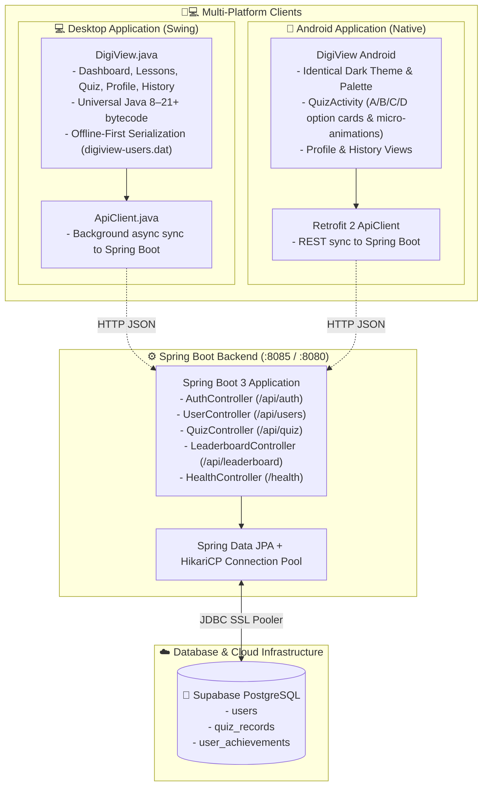

# 🏛️ DigiView Learning Management System - Architecture & Project Structure

Welcome to the **DigiView System** repository. This document provides a complete visual diagram, directory tree, and detailed explanation of every directory and file across the **Desktop Application (Java Swing)**, **Backend Server (Spring Boot & Supabase)**, and **Android Mobile Client**.

---

## 🌐 System Architecture Diagram



---

## 📂 Visual Directory Tree

```text
Digi_View_System/
│
├── 📜 digiview.bat               # 👑 Unified Master CLI & interactive menu (install, apk, dist, run, server, exit)
├── 📜 README.md                  # Beginner-friendly guide & developer instructions
├── 📜 PROJECT_STRUCTURE.md       # Complete repository architecture and documentation
├── 📜 RELEASE_NOTES.md           # Comprehensive release notes and system enhancements
├── 📜 build.xml                  # Apache Ant build script for NetBeans IDE
├── 📜 manifest.mf                # JAR Manifest defining main entry point System.DigiView
├── ⚙️ render.yaml               # ☁️ Render Cloud Blueprint specification (Infrastructure as Code)
├── 🙈 .gitignore                 # Excludes build/, dist/, bin/, *.log, .gradle/, .env
│
├── 📁 config/                    # ⚙️ SYSTEM CONFIGURATIONS & PERSISTENT DATA
│   ├── ⚙️ digiview-config.properties # Server endpoint & API URL persistence
│   └── 💾 digiview-users.dat     # Local binary serialization file (offline-first fallback)
│
├── 📁 scripts/                   # 📜 AUTOMATION & PACKAGING BATCH SCRIPTS
│   ├── 📜 run.bat                # One-click desktop development runner & live log listener
│   ├── 📜 build-release.bat      # Universal multi-version desktop JAR & zero-install packager
│   ├── 📜 build-android.bat      # 📱 One-click Android APK compiler (auto-SDK detection)
│   └── 📜 manage-android.bat     # 📱 Android management toolkit (build, run, install, logs, devices)
│
├── 📁 .vscode/                   # IDE Run & Debug configurations
│   ├── ⚙️ launch.json            # F5 one-key launcher config
│   └── ⚙️ settings.json          # Source path (src) and output path (bin) bindings
│
├── 📁 nbproject/                 # Apache NetBeans project configuration
│   ├── ⚙️ build-impl.xml         # Ant build targets generated by NetBeans
│   ├── ⚙️ genfiles.properties    # NetBeans CRC checksum tracker
│   ├── ⚙️ project.properties     # Universal Java 8 (1.8) source/target level & classpath
│   └── ⚙️ project.xml            # NetBeans project type and metadata
│
├── 📁 src/System/                # 💻 DESKTOP SWING APPLICATION
│   ├── ☕ ApiClient.java         # Pure Java HTTP client syncing quiz & profile data to backend
│   ├── ☕ DigiView.java          # Complete desktop LMS GUI (Dashboard, Lessons, Quiz, Profile, History)
│   └── 📁 sounds/                # Audio sound effects
│       ├── 🔊 freesound_community-relax-32200.mp3
│       ├── 🔊 mixkit-select-click-1109.wav
│       └── 🔊 mixkit-single-key-type-2533.wav
│
├── 📁 backend/                   # ⚙️ SPRING BOOT & SUPABASE BACKEND
│   ├── 🐳 Dockerfile             # Multi-stage production container for Render deployment
│   ├── 📄 .dockerignore          # Excludes build caches and secrets from container image
│   ├── 🔒 .env                   # Local secrets (gitignored, contains real Supabase password)
│   ├── 📜 .env.example           # Safe template for credentials (committed to git)
│   ├── 📜 build.gradle           # Spring Boot 3.3.4, JPA, PostgreSQL, Validation
│   ├── 📜 settings.gradle        # Project naming (digiview-backend)
│   ├── 📜 gradlew / gradlew.bat  # Standalone Gradle wrappers for CI/CD and terminal builds
│   ├── 📜 run-backend.bat        # One-click script to run the Spring Boot server
│   ├── 📜 schema.sql             # Supabase PostgreSQL DDL (tables, constraints, indexes)
│   └── 📁 src/
│       ├── 📁 main/
│       │   ├── 📁 resources/
│       │   │   ├── ⚙️ application.properties # Supabase DB connection URL, pool, and server port
│       │   │   └── 📁 static/
│       │   │       └── 🌐 index.html         # Interactive server health dashboard & Cyber Dino minigame
│       │   └── 📁 java/com/digiview/
│       │       ├── ☕ DigiViewApplication.java # Spring Boot main entry point (auto-loads .env)
│       │       ├── 📁 config/
│       │       │   └── ☕ CorsConfig.java       # Cross-Origin configuration for Desktop & Mobile
│       │       ├── 📁 entity/                   # JPA Database Tables
│       │       │   ├── ☕ UserEntity.java        # maps to 'users' table
│       │       │   ├── ☕ QuizRecordEntity.java  # maps to 'quiz_records' table
│       │       │   └── ☕ AchievementEntity.java # maps to 'user_achievements' table
│       │       ├── 📁 repository/               # Spring Data JPA Repositories
│       │       │   ├── ☕ UserRepository.java
│       │       │   ├── ☕ QuizRecordRepository.java
│       │       │   └── ☕ AchievementRepository.java
│       │       ├── 📁 controller/               # Spring Boot REST Controllers
│       │       │   ├── ☕ AuthController.java   # /api/auth/register, /api/auth/login
│       │       │   ├── ☕ UserController.java   # /api/users/{username}, /api/users/{username}/xp
│       │       │   ├── ☕ QuizController.java   # /api/quiz/record, /api/quiz/history/{username}
│       │       │   ├── ☕ LeaderboardController.java # /api/leaderboard
│       │       │   └── ☕ HealthController.java # /health, /, /api/health for Render uptime monitoring
│       │       └── 📁 dto/                      # Data Transfer Objects (DTOs)
│       │           ├── ☕ ApiResponse.java
│       │           ├── ☕ AuthRequest.java
│       │           ├── ☕ RegisterRequest.java
│       │           ├── ☕ QuizRecordDto.java
│       │           ├── ☕ UserProfileDto.java
│       │           └── ☕ LeaderboardEntryDto.java
│       └── 📁 test/
│           └── 📁 java/com/digiview/
│               └── ☕ DatabaseSyncTest.java     # Automated Supabase connectivity & schema test
│
├── 📁 android/                   # 📱 ANDROID NATIVE PORT
│   ├── 📜 build.gradle           # Root Gradle build file with Google & Maven repositories
│   ├── 📜 settings.gradle        # Includes ':app' module
│   └── 📁 app/
│       ├── 📜 build.gradle       # SDK 34, ViewBinding, Material Components, Retrofit 2
│       └── 📁 src/main/
│           ├── 📄 AndroidManifest.xml # Internet permissions & MainActivity declaration
│           ├── 📁 res/
│           │   ├── 📁 values/
│           │   │   ├── 🎨 colors.xml # Exact hex tokens from Swing (#050F23, #071120, #0E1B30, etc.)
│           │   │   └── 🎨 themes.xml # Dark theme matching desktop aesthetics
│           │   ├── 📁 drawable/      # UI Shapes & Custom Renderers
│           │   │   ├── 🖼️ bg_gradient.xml       # Diagonal background gradient
│           │   │   ├── 🖼️ bg_card.xml           # 22dp rounded card with border stroke
│           │   │   ├── 🖼️ bg_hero.xml           # Header hero banner with cyan accent
│           │   │   ├── 🖼️ bg_chip.xml           # Semi-transparent pill chip for XP/Level
│           │   │   ├── 🖼️ bg_chip_gold.xml      # Gold badge chip for status and ranks
│           │   │   ├── 🖼️ bg_code_container.xml # Monospace syntax preview container
│           │   │   ├── 🖼️ bg_progress_pill.xml  # Dual-tone level progress bar
│           │   │   ├── 🖼️ bg_badge_success.xml  # PASSED status badge
│           │   │   ├── 🖼️ bg_badge_danger.xml   # FAILED / EXITED status badge
│           │   │   ├── 🖼️ bg_avatar.xml         # Circular avatar with cyan glow
│           │   │   ├── 🖼️ bg_button.xml         # Blue rounded pill with ripple effect
│           │   │   ├── 🖼️ bg_option_normal.xml  # Interactive quiz option (default state)
│           │   │   ├── 🖼️ bg_option_correct.xml # Correct answer green outline & soft tint
│           │   │   ├── 🖼️ bg_option_wrong.xml   # Wrong answer red outline & soft tint
│           │   │   └── 🖼️ bg_bottom_nav.xml     # Bottom navigation border styling
│           │   ├── 📁 anim/          # Micro-animations
│           │   │   ├── ✨ card_pop.xml # Subtle bounce scale for selections
│           │   │   ├── ✨ fade_in.xml  # Smooth screen transitions
│           │   │   └── ✨ slide_up.xml # Smooth card entry
│           │   └── 📁 layout/
│           │       ├── 📱 activity_main.xml       # Top bar (XP/Level/Avatar), dynamic content frame, bottom nav
│           │       ├── 📱 layout_dashboard.xml    # Greeting hero, 4 stat tiles, quick action cards
│           │       ├── 📱 layout_lessons.xml      # 7 HTML curriculum module cards
│           │       ├── 📱 dialog_lesson_detail.xml# Modal lesson reader with monospace code blocks
│           │       ├── 📱 layout_quiz_hub.xml     # 3-tier difficulty hub & live quiz runner with 5 hearts
│           │       ├── 📱 layout_profile.xml      # Profile hero, avatar glow, 2x2 stats, level progress
│           │       ├── 📱 layout_history.xml      # Dynamic list of past quiz attempts with status badges
│           │       ├── 📱 dialog_auth.xml         # Account & cloud sync settings modal
│           │       ├── 📱 item_lesson_card.xml    # Reusable lesson card layout
│           │       └── 📱 item_history_card.xml   # Reusable quiz history card layout
│           └── 📁 java/com/digiview/lms/
│               ├── ☕ MainActivity.java # Master controller: SharedPreferences, 5 tabs, quiz engine, sync
│               ├── 📁 model/        # Android POJO models (User, QuizRecord, UserProfile, etc.)
│               └── 📁 api/          # Retrofit API interface & client connecting to Spring Boot
│
└── 📁 dist/                      # 📦 PACKAGED BINARIES & RUNTIME
    ├── ☕ DigiViewSystem.jar     # Standalone runnable JAR
    ├── 📱 DigiView-Android.apk   # Compiled Android mobile app
    └── 🗜️ DigiView-Portable.zip  # Zero-dependency Windows bundle with embedded Java 17 JRE
```

---

## 🔎 Detailed Folder & File Breakdown

### 1. Root Files & Master CLI
| File | Description |
| :--- | :--- |
| [`digiview.bat`](digiview.bat) | 👑 **Unified Master CLI & interactive menu**. Supports single-command execution: `digiview install`, `apk`, `dist`, `run`, `server`, `health`, `devices`, `logs`, `clean`, `exit`. |
| [`README.md`](README.md) | Beginner-friendly project overview, architecture diagram, and step-by-step developer guide. |
| [`PROJECT_STRUCTURE.md`](PROJECT_STRUCTURE.md) | Comprehensive architecture documentation with visual diagrams and file breakdowns. |
| [`RELEASE_NOTES.md`](RELEASE_NOTES.md) | Full release notes, version history, JVM compatibility guide, and changelogs. |
| [`render.yaml`](render.yaml) | Infrastructure as Code (IaC) blueprint for one-click deployment to Render. Configures Docker runtime, health check path, and environment variables. |
| [`build.xml`](build.xml) | Standard Apache Ant build script used by Apache NetBeans for building, cleaning, and running the project. |
| [`manifest.mf`](manifest.mf) | Manifest configuration designating `System.DigiView` as the Main-Class. |
| [`.gitignore`](.gitignore) | Configured to ignore compiled bytecode (`bin/`, `build/`, `dist/`), temporary logs (`*.log`), secrets (`.env`), and build caches (`.gradle/`). |

---

### 2. Configuration & Persistent Data (`config/`)
| File | Description |
| :--- | :--- |
| [`config/digiview-config.properties`](config/digiview-config.properties) | Central persistent desktop configuration file. Stores backend server URL (`server.url`, `digiview.api.url`) so cloud connections persist across sessions. |
| [`config/digiview-users.dat`](config/digiview-users.dat) | Local binary serialization file storing offline user accounts, history, and achievements for offline-first resilience. |

---

### 3. Automation & Packaging Scripts (`scripts/`)
| File | Description |
| :--- | :--- |
| [`scripts/run.bat`](scripts/run.bat) | Development console and live log monitor runner. Compiles changed Java classes with universal `--release 8` flag and streams live JVM logs directly to the terminal. |
| [`scripts/build-release.bat`](scripts/build-release.bat) | Universal desktop release packager. Compiles Java 8 bytecode (v52.0), packages `dist/DigiViewSystem.jar`, bundles zero-install runtime with `jlink`, compiles native `DigiView.exe`, and compresses `dist/DigiView-Portable.zip`. |
| [`scripts/build-android.bat`](scripts/build-android.bat) | One-click Android APK builder. Automatically detects Android SDK, generates `local.properties`, runs Gradle compilation, and packages `dist/DigiView-Android.apk`. |
| [`scripts/manage-android.bat`](scripts/manage-android.bat) | High-level Android toolkit CLI and interactive menu. Supports single-command execution: `build`, `run` (installs & launches on device), `install`, `devices`, `logs`, and `clean`. |

---

### 4. Desktop Application (`src/System/`)
| File / Folder | Purpose & Details |
| :--- | :--- |
| [`DigiView.java`](src/System/DigiView.java) | The central desktop application file (~3100 lines). Implements the complete Dark-themed Learning Management System using Java Swing: Dashboard, interactive Lessons with syntax blocks, interactive HTML Quiz with hearts and score locks, History attempt cards with progress bars and badges, and student Profile with 2x2 grid and Level XP progress. |
| [`ApiClient.java`](src/System/ApiClient.java) | Pure Java HTTP networking client using `java.net.HttpURLConnection` (0 third-party dependencies, Java 8–21+ compatible). Asynchronously transmits registration, quiz attempts, and achievements to the Spring Boot backend in background daemon threads while preserving local file persistence (`config/digiview-users.dat`) as an offline fallback. |
| `sounds/` | Audio resources for UI interaction (`mixkit-select-click-1109.wav` on buttons and quiz options, background music, typing sounds). |

---

### 5. Backend Service (`backend/`)
| File / Folder | Purpose & Details |
| :--- | :--- |
| [`Dockerfile`](backend/Dockerfile) | Production multi-stage Docker build. Compiles the Spring Boot JAR with Temurin 17 and packages a lightweight JRE image with tuned memory parameters (`-Xmx384m`) optimized for Render's 512MB RAM free tier. |
| [`.dockerignore`](backend/.dockerignore) | Excludes build directories, caches, and `.env` credentials from the Docker build context. |
| [`.env`](backend/.env) | Local secrets file (gitignored, contains real Supabase credentials and port configuration). |
| [`.env.example`](backend/.env.example) | Safe template for credentials committed to git for team onboarding. |
| [`schema.sql`](backend/schema.sql) | Supabase PostgreSQL database definition. Creates `users`, `quiz_records`, and `user_achievements` tables with foreign keys and performance indexes. |
| [`application.properties`](backend/src/main/resources/application.properties) | Database connectivity configurations (JDBC SSL URL for Supabase, Hikari connection pool limits, dynamic `${PORT:8080}`). |
| [`run-backend.bat`](backend/run-backend.bat) | Batch script to start the Spring Boot server using Gradle with automatic `.env` parameter loading. |
| [`controller/`](backend/src/main/java/com/digiview/controller/) | REST API layer handling HTTP requests: registration, authentication, quiz submissions, history queries, leaderboard rankings, and content-negotiated `/health` & `/` serving an interactive browser health dashboard with a Cyber Dino arcade runner alongside structured JSON telemetry for uptime monitors. |
| [`entity/`](backend/src/main/java/com/digiview/entity/) | JPA mapping classes representing persistent database rows (`UserEntity`, `QuizRecordEntity`, `AchievementEntity`). |
| [`repository/`](backend/src/main/java/com/digiview/repository/) | Spring Data JPA interfaces providing automated CRUD and queries (`findByUsernameIgnoreCase`, `findTop50ByOrderByXpDesc`). |
| [`dto/`](backend/src/main/java/com/digiview/dto/) | Request and response data transfer objects including a unified `ApiResponse<T>` wrapper. |
| [`DatabaseSyncTest.java`](backend/src/test/java/com/digiview/DatabaseSyncTest.java) | Automated integration test that validates live Supabase connection and public schema tables. |

---

### 6. Android Mobile Client (`android/`)
| File / Folder | Purpose & Details |
| :--- | :--- |
| [`colors.xml`](android/app/src/main/res/values/colors.xml) | Pixel-perfect port of desktop Swing color constants (`#050F23`, `#071120`, `#0E1B30`, `#1E304C`, `#38BDF8`, `#2563EB`, `#22C55E`, `#EF4444`). |
| `res/drawable/` | Custom XML shapes and selectors reproducing Swing custom painting: gradients (`bg_gradient.xml`), 22dp rounded containers (`bg_card.xml`), hero banner (`bg_hero.xml`), level progress pill (`bg_progress_pill.xml`), status badges (`bg_badge_success.xml`, `bg_badge_danger.xml`, `bg_badge_gold.xml`), and quiz option state changes (Normal, Selected, Correct, Wrong). |
| `res/anim/` | Micro-animations including `card_pop.xml` (overshoot scale bounce on selection) and smooth alpha transitions (`fade_in.xml`, `slide_up.xml`). |
| `res/layout/` | Complete modular layouts matching desktop Swing panels: Top Bar with Live XP & Level badges (`activity_main.xml`), Dashboard with greeting hero & stat cards (`layout_dashboard.xml`), 7 HTML curriculum cards (`layout_lessons.xml`), Lesson reader with dark code preview (`dialog_lesson_detail.xml`), 3-tier Quiz Hub & Active Runner with 5 hearts (`layout_quiz_hub.xml`), Profile with 2x2 grid & level progress (`layout_profile.xml`), History attempt list with status badges (`layout_history.xml`), and Account/Sync settings modal (`dialog_auth.xml`). |
| [`MainActivity.java`](android/app/src/main/java/com/digiview/lms/MainActivity.java) | Master Android controller matching desktop Swing functionality: Offline-first persistence via `SharedPreferences`, bottom tab navigation, full quiz runner with hearts and scoring locks, HTML lesson viewer modal, and background Spring Boot cloud sync. |
| `api/` & `model/` | Type-safe Retrofit 2 networking client connecting directly to Spring Boot REST endpoints (`/api/quiz/record`, `/api/auth/register`, `/api/users/{username}`) with dynamic server URL configuration. |

---

## 🚀 How to Run Each Component

### A. Run Desktop App
* **Via Master CLI:** Run `digiview run` in any terminal or command prompt.
* **In Antigravity / VS Code:** Press **`F5`** or click **Run** above line 29 in [`src/System/DigiView.java`](src/System/DigiView.java).
* **In NetBeans:** Press **`F6`** (Source/Binary level is set to universal `1.8`).
* **From Windows Explorer:** Double-click [`scripts/run.bat`](scripts/run.bat).

### B. Run Backend Server (Locally)
1. Run [`backend/schema.sql`](backend/schema.sql) in your [Supabase SQL Editor](https://supabase.com) (or let Hibernate create tables automatically).
2. Configure your credentials in `backend/.env`.
3. Double-click [`backend/run-backend.bat`](backend/run-backend.bat) (or run `digiview server`).

### C. Deploy Backend to Render (Cloud Hosting)
1. In your [Render Dashboard](https://dashboard.render.com), click **New** &rarr; **Blueprint** (or **Web Service**).
2. Connect your GitHub repository.
3. Render automatically detects [`render.yaml`](render.yaml) and builds via [`backend/Dockerfile`](backend/Dockerfile).
4. Enter your 3 environment variables in Render (`SUPABASE_DB_URL`, `SUPABASE_DB_USER`, `SUPABASE_DB_PASSWORD`).
5. Render deploys your backend live with automatic SSL (`https://digi-view-system.onrender.com`) and validates `/health`!

### D. Distribute Desktop App to Other PCs
1. Run `digiview dist` or [`scripts/build-release.bat`](scripts/build-release.bat).
2. Share `dist/DigiView-Portable.zip`. Users simply unzip and run `DigiView.bat` without installing Java!
